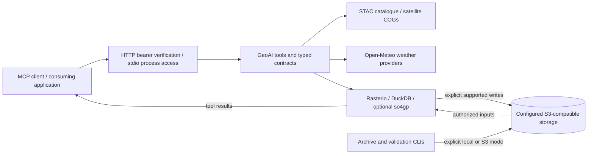

# Architecture and data flow

GeoAI is an independent Python MCP server. It exposes 16 tools and read-only
resources to compatible clients. The consuming application owns its interface,
document retrieval, scheduling, notifications and user/space authorization.

## Request boundary

[The server entry point](../src/server.py) registers tools, resources and the
`/health` route. HTTP clients connect to `/mcp`; stdio clients launch the process.
[Mesh bearer verification](../src/auth.py) checks a configured shared service
secret. HTTP/SSE data-plane or solar deployments require a token at startup.
That service credential does not establish a tenant's right to an arbitrary
object: a consuming application must authorize the user, space and requested
dataset before passing permitted inputs to the server.

[Input and output contracts](../src/contracts.py) describe tool arguments and
results. [The public MCP guide](../reference/mcp-tools.md) explains individual
tools, prerequisites and examples. Credential redaction covers tool responses
and errors through [the middleware](../src/utils/mcp_redaction.py); deployment
configuration and source validation remain separate controls.

## Providers and computation

- [STAC tools](../src/tools/stac.py) discover scenes and band locations.
  [NDVI ingestion](../src/tools/climate.py) and
  [raster helpers](../src/utils/raster.py) process observations; the retained
  historical runs stream COG inputs rather than archive original imagery.
- [Climate tools](../src/tools/climate.py) prepare historical weather, monthly
  distributions, aligned series and threshold classifications.
  [Forecast tools](../src/tools/forecast.py) expose bounded provider lookups and
  model/fallback metadata. Missing data and model-issuance limits remain visible.
- [Spatial tools](../src/tools/spatial.py) query permitted GeoParquet inputs
  with DuckDB. [Pattern tools](../src/tools/patterns.py) use the optional pinned
  CPU so4gp profile. Native pattern extraction and an explanatory index do not
  establish predictive skill or calibrated event probabilities.

## Storage is explicit

Storage-free tools can return results without a configured object store. Stored
data workflows use configured S3-compatible storage, or explicitly enabled
local sources confined to a configured root. RustFS can provide the S3 API;
deployment owners supply endpoints, buckets, credentials and access permissions.
The public repository does not contain operational tenant stores or service
secrets.

Supported tool writes are governed by each handler's arguments and validation;
there is no automatic S3 persistence of every MCP response. `forecast_query`
defaults to `write_output=false`; `era5_ingest` defaults to writing its output,
and an explicit `write_output=false` enables a storage-free probe.
[Forecast ensemble archiving](../src/cli/forecast_ensemble_archive.py) is a
separate CLI with explicit local/S3 storage modes, scoped destinations and
conditional publication of immutable artifacts and manifests.

Fixed research inputs under [src/data](../src/data) support bounded historical
and saved-input calculations; [src/contracts_data/watch](../src/contracts_data/watch)
holds local validation schemas. These packaged artifacts are distinct from a
deployment's S3 datasets. Retain their provenance and [data notices](../NOTICE).

## Application integration and evidence

An application may render tool results, retain them with provenance, or schedule
authorized calls. Those capabilities are outside this independent server.
The [FIERCE dossier](evidence/fierce-kpi-evidence.en.md) records dated integrated
demonstrations and their limitations. Publishing the code does not reproduce
those environments, transfer private data or qualify a new deployment.
